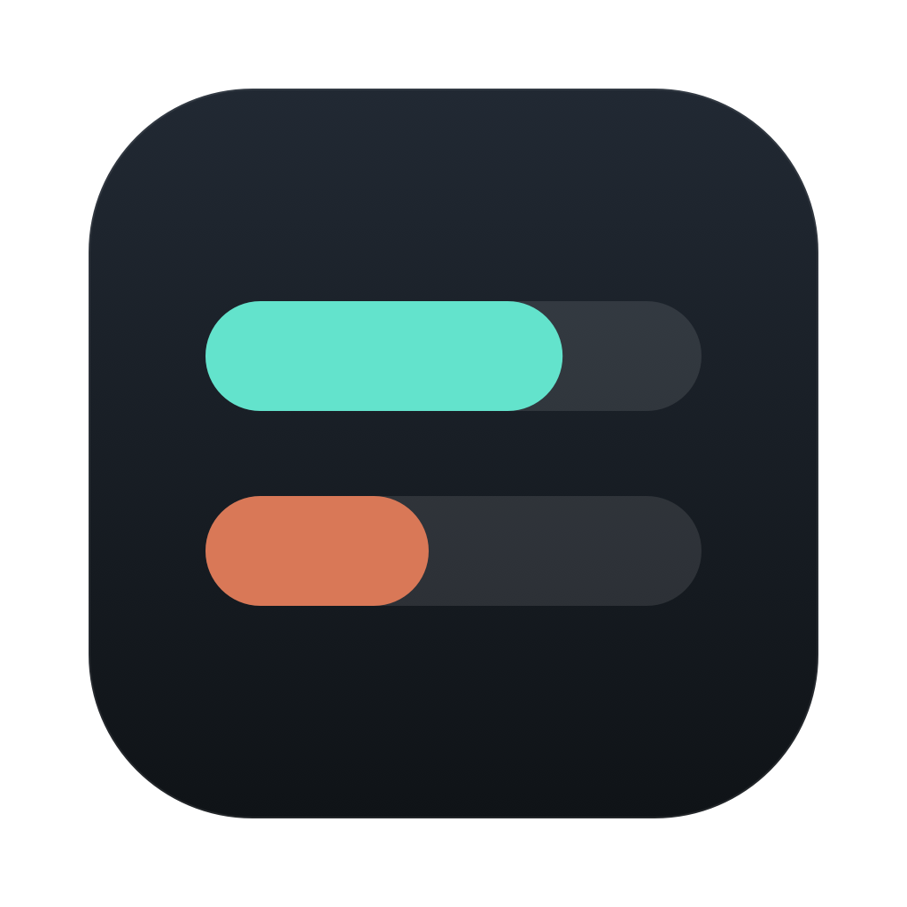
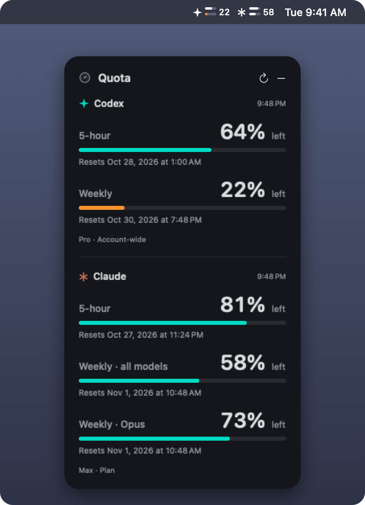

<p align="center"></p>

# Quota Float

A small macOS floating panel and menu-bar gauge that shows how much of your **Codex** (ChatGPT plan) quota and **Claude** plan usage limits you have left.

<p align="center"></p>

- Every 5-hour, weekly and per-model window, as a percentage **remaining**, with its reset time in your local timezone.
- A compact menu-bar gauge: for Codex (✦) and Claude (✱), two stacked bars (5-hour on top, weekly below) and the lower of the two percentages. Bars turn orange at 25% and red at 10%. Hover or open the menu for the full text.
- Stays above other windows on every Space. Drag the title to move it; the position is remembered.
- If a refresh fails, the last values stay visible with a stale-data notice. Missing values are shown as unavailable, never guessed.

Quota Float is an independent project. It is not affiliated with or endorsed by OpenAI or Anthropic.

## Requirements

- macOS 13 Ventura or later, on Apple silicon or Intel.
- For Codex: the [Codex CLI](https://github.com/openai/codex), signed in with ChatGPT (`codex login`).
- For Claude: [Claude Code](https://docs.claude.com/en/docs/claude-code), signed in with your Claude plan (`claude auth login`).

Each service is optional; one that isn't set up shows a short explanation instead of numbers.

## Install

1. Download `QuotaFloat-<version>.zip` from the [latest release](../../releases/latest) and unzip it.
2. Move **Quota Float.app** to Applications.
3. Release builds are ad-hoc signed, not notarized, so macOS blocks the first launch. Either right-click the app and choose **Open**, or run:

   ```bash
   xattr -dr com.apple.quarantine "/Applications/Quota Float.app"
   ```

To start it at login, add it in **System Settings → General → Login Items**.

## Usage

- **Refresh** (↻) updates both services now. Codex refreshes every minute and Claude every five minutes, plus after waking from sleep.
- **Hide** (−) hides the panel; reopen it from the menu-bar gauge, which also has Refresh and Quit.

From a terminal, the bundled binary can also print the current numbers without opening a window:

```bash
"/Applications/Quota Float.app/Contents/MacOS/QuotaFloat" --check
```

## How it works and privacy

Quota Float never reads, stores or sends credentials, and never calls a model. It asks each CLI, which manages its own sign-in, for the numbers:

- **Codex:** starts `codex app-server` and calls its documented [`account/rateLimits/read`](https://learn.chatgpt.com/docs/app-server) method.
- **Claude:** starts `claude -p` in stream-JSON mode and sends only the `get_usage` control request (the data behind `/usage`). No prompt is sent, so nothing counts against your limits. Session saving, MCP servers and hooks are turned off for that process. Claude Code marks this request as experimental, so a future CLI version may change it.

Claude plan limits only exist for plan sign-ins, so API-key and gateway variables (`ANTHROPIC_*`, `CLAUDE_CODE_*` except `CLAUDE_CODE_OAUTH_TOKEN`) are removed from the Claude process's environment.

The CLIs are found at `CODEX_BINARY` / `CLAUDE_BINARY` if set, otherwise `~/.local/bin`, `/opt/homebrew/bin`, `/usr/local/bin`, and for Codex the Codex app's bundled binary. The CLI accounts can differ from the ones used in the desktop apps.

The only thing Quota Float stores is its window position, in its macOS preferences.

## Build from source

Requires Xcode or the Command Line Tools (Swift 5.9 or later).

```bash
scripts/test.sh     # unit tests
scripts/build.sh    # build/Quota Float.app and build/QuotaFloat-<version>.zip (universal)
open "build/Quota Float.app"
```

`ARCHS=arm64 scripts/build.sh` builds for one architecture only. To sign with a Developer ID and notarize, set `SIGN_IDENTITY` and `NOTARY_PROFILE` (see the top of `scripts/build.sh`). `swift scripts/make-icon.swift` regenerates the icon.

See [docs/ARCHITECTURE.md](docs/ARCHITECTURE.md) for how the code is organised, and [docs/RELEASING.md](docs/RELEASING.md) for publishing a release.

## License

[MIT](LICENSE)
